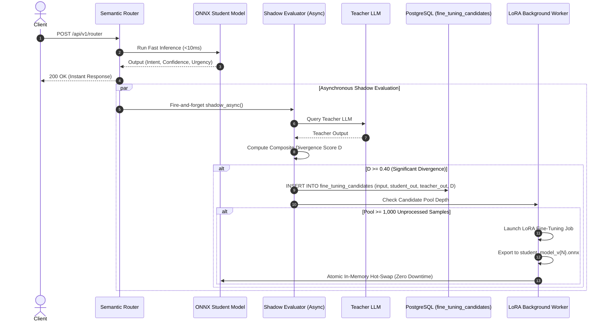
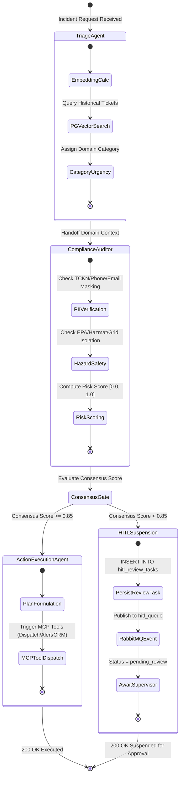
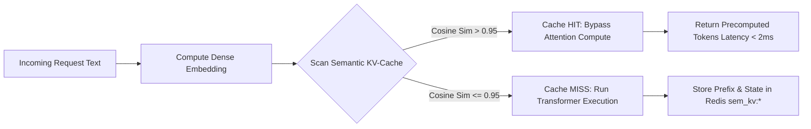

# Advanced Architectural Guide: Self-Evolving & Multi-Agent Ecosystem (NDTM) 🧠

This document details the cutting-edge autonomous AI engineering modules implemented in the **Neuro-Distilled Triage Mesh (NDTM)** platform.

---

## 1. Self-Evolving Continuous Fine-Tuning & Active Learning Pipeline

### A. Shadow Testing & Semantic Divergence Scoring
During standard operation, the platform routes 80%+ of incoming traffic to the ultra-fast local ONNX student model (`< 10ms` latency, `$0.00` API cost). To guarantee model accuracy and prevent drift over time, the `ShadowTestingEvaluator` asynchronously mirrors requests to the Teacher LLM in the background.

The student and teacher predictions are compared using a normalized composite divergence formula:
$$\text{Divergence Score } D = w_{\text{intent}} \cdot \mathbb{I}(\text{Intent}_{\text{student}} \neq \text{Intent}_{\text{teacher}}) + w_{\text{urgency}} \cdot \min(1.0, |\text{Urgency}_{\text{student}} - \text{Urgency}_{\text{teacher}}|)$$

Where:
- $w_{\text{intent}} = 0.65$ (Intent categorization mismatch penalty)
- $w_{\text{urgency}} = 0.35$ (Severity delta weight)
- $\mathbb{I}(\cdot)$ is the indicator function ($1$ if mismatch, $0$ if match).



### B. Parameter-Efficient Fine-Tuning (LoRA) & Zero-Downtime Hot-Swap
Once 1,000 high-divergence edge cases accumulate in PostgreSQL:
1. **Dataset Curation:** The background pipeline locks and extracts the top divergence candidate pairs.
2. **LoRA Fine-Tuning:** Parameter-Efficient Fine-Tuning freezes the backbone model and trains low-rank adapter matrices $W = W_0 + B \cdot A$ with rank $r=8$ and scaling $\alpha=16$.
3. **ONNX Graph Export:** The adapted weights are fused and exported into an optimized ONNX computation graph.
4. **Atomic Pointer Hot-Swap:** In `ONNXStudentRunner`, the active `ort.InferenceSession` reference is replaced atomically in memory. Ongoing requests complete without interruption, while subsequent requests immediately execute on the new model iteration.

---

## 2. Multi-Agent Collaborative Workflow (LangGraph State Machine)

Complex civic and enterprise incidents require collaborative reasoning rather than single-prompt execution. NDTM implements an autonomous state machine composed of three specialized agents:



### Specialized Agents:
1. **Triage & Domain Specialist Agent (`triage_agent.py`):**
   - Categorizes incoming descriptions into municipal domains (`plumbing`, `electrical`, `pavement`, `hazmat`, `networking`, `general`).
   - Retrieves top-3 historical cases and resolutions via pgvector cosine similarity to enrich operational context.
2. **Risk & Compliance Auditor Agent (`auditor_agent.py`):**
   - Enforces privacy regulations (GDPR / KVKK) by ensuring no raw PII leaks into action plans.
   - Audits emergency protocols (e.g. hazardous material requires mandatory disaster protocol checks and first responder alerts).
3. **Action Execution Agent (`execution_agent.py`):**
   - Formulates concrete mitigation actions and executes external integrations using standard **Model Context Protocol (MCP)** tool schemas (`dispatch_technician_crew`, `notify_emergency_services`, `update_public_works_crm`).

### Human-in-the-Loop (HITL) Consensus Protocol
Consensus confidence is computed dynamically:
$$\text{Consensus Score} = (C_{\text{triage}} \times 0.40) + (C_{\text{auditor}} \times 0.45) + (0.15 \text{ if Compliant else } 0.0)$$

- **If $\text{Consensus Score} \ge 0.85$:** Autonomous execution proceeds without human friction.
- **If $\text{Consensus Score} < 0.85$:** The state machine suspends execution, persists state into PostgreSQL `hitl_review_tasks`, and publishes a priority message to RabbitMQ `hitl_queue`. Human supervisors can inspect and resolve the suspended task via `/api/v1/agents/hitl/{task_id}/resolve`.

---

## 3. Distributed Semantic KV-Cache Pool & Context Reuse

Traditional LLM and Transformer inference spends up to 70% of compute time recalculating attention key-value states for common prompt prefixes.



### Key Technical Characteristics:
- **Shared Cluster Storage:** Backed by Redis with fallback to local fast memory.
- **Semantic Prefix Lookup:** Evaluates cosine similarity:
  $$\text{Cosine Similarity}(\vec{q}, \vec{k}) = \frac{\vec{q} \cdot \vec{k}}{\|\vec{q}\|_2 \|\vec{k}\|_2} > 0.95$$
- **Attention Bypass:** When similarity exceeds $0.95$, transformer attention layers are completely bypassed. Precomputed tokens and KV-cache representations are reused directly, lowering end-to-end response times from $\sim 200\text{ms}$ to $< 2\text{ms}$.

---

## 4. Zero-Trust Federated Learning & Privacy-Preserving Edge Simulation

In municipal and enterprise environments, edge nodes (e.g., district branches, private factory sites) cannot transmit raw incident data to a central cloud due to data sovereignty, security, and privacy constraints.

NDTM provides a simulation suite in `ndtm_platform/federated/edge_simulator.py`:

```mermaid
graph TD
    subgraph "Central Aggregator Node"
        Global[Global Model Parameters W_global]
        FedAvg[Federated Averaging FedAvg]
    end

    subgraph "Edge Node 1 (Factory North)"
        DB1[(Isolated SQLite DB)] --> Train1[Local SGD Training]
        Train1 --> Clip1[Gradient Clipping ||g|| <= C]
        Clip1 --> Noise1[Add Gaussian DP Noise N 0, sigma^2]
        Noise1 --> Delta1[Privatized Delta Delta_W1]
    end

    subgraph "Edge Node 2 (Branch Office East)"
        DB2[(Isolated SQLite DB)] --> Train2[Local SGD Training]
        Train2 --> Clip2[Gradient Clipping ||g|| <= C]
        Clip2 --> Noise2[Add Gaussian DP Noise N 0, sigma^2]
        Noise2 --> Delta2[Privatized Delta Delta_W2]
    end

    Delta1 --> FedAvg
    Delta2 --> FedAvg
    FedAvg --> Global
    Global -.-> |Broadcast Updated Weights| EdgeNode1
    Global -.-> |Broadcast Updated Weights| EdgeNode2
```

### Mathematical Formulation of Differential Privacy:
1. **Gradient Sensitivity Bound:** Gradients are clipped to $L_2$ norm threshold $C$:
   $$\bar{g} = g \cdot \min\left(1, \frac{C}{\|g\|_2}\right)$$
2. **Gaussian Noise Addition:** To satisfy $(\epsilon, \delta)$-Differential Privacy, noise scale $\sigma$ is calibrated:
   $$\sigma = \frac{C \cdot \sqrt{2 \ln(1.25 / \delta)}}{\epsilon}$$
   $$\tilde{\Delta} W = \Delta W + \mathcal{N}(0, \sigma^2 I)$$
3. **Federated Averaging (`FedAvg`):** The central aggregator computes:
   $$W_{\text{global}}^{(t+1)} = W_{\text{global}}^{(t)} + \sum_{k=1}^K \frac{n_k}{N} \tilde{\Delta} W_k$$
   Raw records never leave the local edge SQLite database, providing mathematical zero-trust guarantees.

---

## 5. Summary of Endpoints for Advanced Modules

| Endpoint | Method | Advanced Module | Description |
| :--- | :--- | :--- | :--- |
| `/api/v1/agents/workflow` | `POST` | Multi-Agent | Autonomous execution with HITL threshold check ($0.85$). |
| `/api/v1/agents/hitl/tasks` | `GET` | Multi-Agent | List pending supervisor review tasks. |
| `/api/v1/agents/hitl/{id}/resolve` | `POST` | Multi-Agent | Approve or reject a suspended workflow task. |
| `/api/v1/learning/status` | `GET` | Continuous Learning | Unprocessed candidate count and training status. |
| `/api/v1/learning/trigger` | `POST` | Continuous Learning | Manually force LoRA retraining and zero-downtime hot-swap. |
| `/api/v1/federated/simulate` | `POST` | Federated Learning | Execute multi-round differential privacy edge simulation. |
